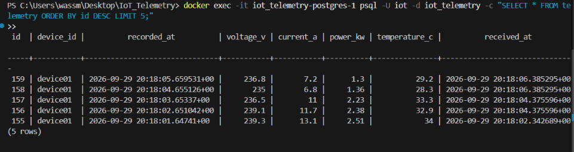

# IoT Telemetry Pipeline

Collects real-time sensor data from a simulated industrial device (voltage, current, active power, temperature), transports it over MQTT, and stores it in PostgreSQL.

```
                         Modbus TCP            MQTT
 data/sample.csv ──> [ Simulator ] ──> [ Gateway ] ──> [ Mosquitto ] ──> [ Ingestor ] ──> [ PostgreSQL ]
                      :5020               poll 1s        :1883             subscribe        :5432
                      holding regs        + publish       broker           + batch insert    telemetry table
```

## Quick start

### 1. Start infrastructure

```bash
docker compose up -d
```

This brings up PostgreSQL (with the schema auto-applied) and the Mosquitto MQTT broker.

### 2. Set up Python environment

```bash
python -m venv venv
# Linux/macOS:
source venv/bin/activate
# Windows:
venv\Scripts\activate

pip install -r requirements.txt
```

### 3. Copy and adjust settings (optional)

```bash
cp .env.example .env
# edit .env if your ports or credentials differ
```

The code reads from environment variables with sensible defaults. You can skip `.env` entirely if running everything locally with default ports.

### 4. Start the pipeline (three terminals)

Terminal 1 -- Modbus device simulator:
```bash
python simulator/modbus_device.py
```

Terminal 2 -- gateway (Modbus -> MQTT):
```bash
python gateway/modbus_to_mqtt.py
```

Terminal 3 -- ingestor (MQTT -> PostgreSQL):
```bash
python ingestor/mqtt_to_postgres.py
```

Data flows immediately. After a few seconds you can query it:

```bash
docker exec -it iot_telemetry-postgres-1 psql -U iot -d iot_telemetry \
  -c "SELECT * FROM telemetry ORDER BY id DESC LIMIT 5;"
```



### 5. Stop

Ctrl+C each process. The ingestor flushes its buffer on shutdown. Then:

```bash
docker compose down        # keeps data
docker compose down -v     # removes volumes too
```

---

## Protocol choices

### Modbus TCP for device communication

Modbus is the standard protocol in industrial automation and energy metering. Nearly every PLC, inverter, and power meter speaks it. Using Modbus TCP here simulates what a real field gateway would do: read registers from a device on the plant floor.

The simulator exposes four 16-bit holding registers at addresses 0-3. Values are scaled integers because Modbus has no floating-point type at the register level.

### MQTT for backend transport

MQTT is a publish/subscribe protocol built for constrained networks and high fan-in (many devices, one backend). It decouples the gateway from the database layer: neither needs to know the other exists. Adding another consumer (dashboards, alerting) means adding another subscriber -- no changes to the gateway.

### QoS 1 (at-least-once)

QoS 0 can silently drop messages. QoS 2 adds a four-step handshake per message, which is unnecessary overhead for telemetry that arrives every second. QoS 1 guarantees delivery with a single ACK. The tradeoff is potential duplicates after reconnects, which is acceptable here (see Limitations).

---

## Modbus register map

| Register | Field       | Unit | Scale factor | Example raw | Real value |
|----------|-------------|------|-------------|-------------|------------|
| 0        | Voltage     | V    | x 10        | 2401        | 240.1 V    |
| 1        | Current     | A    | x 100       | 1450        | 14.50 A    |
| 2        | Active power| kW   | x 100       | 348         | 3.48 kW    |
| 3        | Temperature | C    | x 10        | 421         | 42.1 C     |

All registers are unsigned 16-bit. The gateway divides by the scale factor to recover the float.

---

## MQTT topic and payload

**Topic:** `factory/line1/device01/telemetry`

**Payload** (JSON, QoS 1):
```json
{
  "device_id": "device01",
  "timestamp": "2024-11-15T14:30:22.341000+00:00",
  "voltage_v": 240.1,
  "current_a": 14.5,
  "power_kw": 3.48,
  "temperature_c": 42.1
}
```

The ingestor subscribes to `factory/+/+/telemetry` so it would pick up additional devices on other lines without code changes.

---

## Database schema

```sql
CREATE TABLE devices (
    device_id   VARCHAR(64) PRIMARY KEY,
    location    VARCHAR(128),
    created_at  TIMESTAMPTZ DEFAULT now()
);

CREATE TABLE telemetry (
    id              BIGSERIAL PRIMARY KEY,
    device_id       VARCHAR(64) REFERENCES devices(device_id),
    recorded_at     TIMESTAMPTZ NOT NULL,
    voltage_v       DOUBLE PRECISION,
    current_a       DOUBLE PRECISION,
    power_kw        DOUBLE PRECISION,
    temperature_c   DOUBLE PRECISION,
    received_at     TIMESTAMPTZ DEFAULT now()
);

-- Composite index for time-series queries filtered by device
CREATE INDEX idx_telemetry_device_time ON telemetry (device_id, recorded_at DESC);
```

### Example queries

**Latest 10 readings:**
```sql
SELECT recorded_at, voltage_v, current_a, power_kw, temperature_c
FROM telemetry
WHERE device_id = 'device01'
ORDER BY recorded_at DESC
LIMIT 10;
```
```
      recorded_at          | voltage_v | current_a | power_kw | temperature_c
---------------------------+-----------+-----------+----------+---------------
 2024-11-15 14:30:22+00    |     240.1 |     14.50 |     3.48 |          42.1
 2024-11-15 14:30:21+00    |     238.7 |     12.80 |     3.05 |          38.4
 2024-11-15 14:30:20+00    |     241.3 |     16.20 |     3.91 |          45.6
 ...
```

**Hourly average power over the last 24 hours:**
```sql
SELECT date_trunc('hour', recorded_at) AS hour,
       round(avg(power_kw)::numeric, 3) AS avg_power_kw,
       count(*) AS samples
FROM telemetry
WHERE device_id = 'device01'
  AND recorded_at > now() - interval '24 hours'
GROUP BY hour
ORDER BY hour;
```
```
         hour          | avg_power_kw | samples
-----------------------+--------------+---------
 2024-11-15 00:00+00   |        1.234 |    3600
 2024-11-15 01:00+00   |        0.876 |    3600
 2024-11-15 02:00+00   |        0.542 |    3600
 ...
```

**Daily max temperature:**
```sql
SELECT recorded_at::date AS day,
       max(temperature_c) AS max_temp_c,
       round(avg(temperature_c)::numeric, 1) AS avg_temp_c
FROM telemetry
WHERE device_id = 'device01'
GROUP BY day
ORDER BY day DESC
LIMIT 7;
```
```
    day     | max_temp_c | avg_temp_c
------------+------------+------------
 2024-11-15 |       72.4 |       38.1
 2024-11-14 |       68.9 |       36.7
 ...
```

**Voltage excursions outside normal range:**
```sql
SELECT recorded_at, voltage_v
FROM telemetry
WHERE device_id = 'device01'
  AND (voltage_v < 225.0 OR voltage_v > 250.0)
ORDER BY recorded_at DESC
LIMIT 20;
```

---

## Dataset

Source: [Individual Household Electric Power Consumption](https://archive.ics.uci.edu/ml/datasets/Individual+household+electric+power+consumption) (UCI Machine Learning Repository / Kaggle).

`data/sample.csv` contains 2500 rows with four columns:

| Column      | Source     | Notes |
|-------------|-----------|-------|
| voltage     | Real      | From `Voltage` field (V) |
| current     | Real      | From `Global_intensity` field (A) |
| power       | Real      | From `Global_active_power` field (kW) |
| temperature | Synthetic | Generated as `24 + power * 3.8 + noise`. Simulates equipment temperature that rises with electrical load. Not present in the original dataset. |

The included `sample.csv` was generated with `scripts/generate_sample.py` using distributions that match the original dataset's ranges. To rebuild it from the actual UCI data instead:

```bash
# Download household_power_consumption.txt from UCI/Kaggle
python scripts/prepare_data.py household_power_consumption.txt
```

---

## Configuration

All settings are read from environment variables. Defaults are set for local development with `docker compose up`.

| Variable           | Default                              | Used by          |
|--------------------|--------------------------------------|------------------|
| `MODBUS_HOST`      | `0.0.0.0` (sim) / `127.0.0.1` (gw)  | simulator, gateway |
| `MODBUS_PORT`      | `5020`                               | simulator, gateway |
| `CSV_PATH`         | `data/sample.csv`                    | simulator        |
| `MQTT_HOST`        | `127.0.0.1`                          | gateway, ingestor|
| `MQTT_PORT`        | `1883`                               | gateway, ingestor|
| `MQTT_TOPIC`       | `factory/line1/device01/telemetry`   | gateway          |
| `DEVICE_ID`        | `device01`                           | gateway          |
| `POLL_INTERVAL`    | `1.0`                                | gateway          |
| `POSTGRES_HOST`    | `127.0.0.1`                          | ingestor         |
| `POSTGRES_PORT`    | `5432`                               | ingestor         |
| `POSTGRES_DB`      | `iot_telemetry`                      | ingestor         |
| `POSTGRES_USER`    | `iot`                                | ingestor         |
| `POSTGRES_PASSWORD`| `iotpass`                            | ingestor         |
| `BATCH_SIZE`       | `50`                                 | ingestor         |
| `FLUSH_INTERVAL`   | `2.0` (seconds)                      | ingestor         |

---

## Assumptions and limitations

- **At-least-once delivery.** QoS 1 can produce duplicate rows after MQTT reconnects. For production use, add a deduplication step (e.g. a unique constraint on `(device_id, recorded_at)` or upsert logic).
- **Single device.** The simulator and gateway handle one device. Supporting multiple devices would mean running additional simulator instances on different ports (or multiplexing Modbus unit IDs) and publishing to separate topics.
- **No TLS or authentication.** MQTT and Modbus connections are unencrypted and unauthenticated. Fine for a local demo, not for anything exposed to a network.
- **No backpressure.** If PostgreSQL goes down for a long time, the ingestor's in-memory buffer grows without bound. A production system would use a persistent queue or disk-backed buffer.
- **Clock skew.** The `timestamp` in the payload comes from the gateway's system clock. If the gateway and ingestor run on different machines, `recorded_at` and `received_at` may differ for reasons beyond network delay.
- **Modbus register overflow.** Values are stored as unsigned 16-bit integers (0-65535). Voltage x10 and temperature x10 fit easily. Current x100 and power x100 work for the dataset's ranges but would overflow at 655.35 A or 655.35 kW.

---

## Repository structure

```
.
├── .env.example
├── .gitignore
├── README.md
├── requirements.txt
├── docker-compose.yml
├── mosquitto/
│   └── mosquitto.conf
├── db/
│   └── init.sql
├── data/
│   └── sample.csv
├── scripts/
│   ├── generate_sample.py
│   └── prepare_data.py
├── simulator/
│   └── modbus_device.py
├── gateway/
│   └── modbus_to_mqtt.py
└── ingestor/
    └── mqtt_to_postgres.py
```
